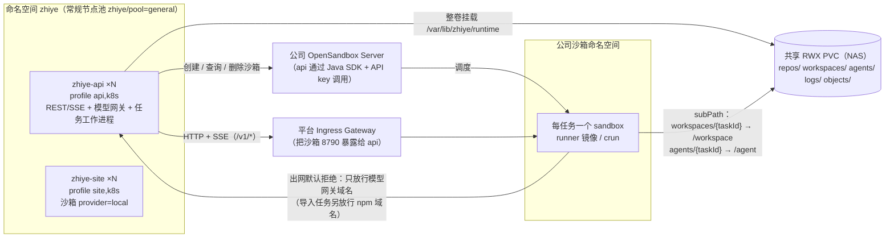

# 织页 Kubernetes 部署与沙箱

本目录是织页在 Kubernetes 上的部署清单（Kustomize，不依赖 Helm）。沙箱使用公司现有的 **OpenSandbox** 服务（crun 运行时）：每个编码任务通过官方 Java SDK 创建一个 OpenSandbox 沙箱，runner 镜像作为沙箱 entrypoint 启动 HTTP 控制服务。

原自研的「每任务一个 Pod + exec」实现（`zhiye.sandbox.provider=k8s`）保留为**回滚路径**，验证期结束后再删除；相关清单在文件里标了「legacy」。

```text
deploy/
├── docker/
│   ├── runner.Dockerfile        runner 沙箱镜像（Node 22 + Chromium + git/python3/bash + 模板依赖），也是 OpenSandbox 的 sandbox 镜像
│   ├── server.Dockerfile        主服务镜像（api / site 同一个镜像，SPRING_PROFILES_ACTIVE 区分）
│   ├── service-base.Dockerfile  给导入服务基础镜像加入公司 CA（Node / Python / Java / Go）
│   ├── csot-root-ca.crt         公司安全网关的公共根 CA（不是私钥）
│   ├── start-runner.sh          镜像内的 runner 启动脚本（修正 node_modules 链接后 exec runner），OpenSandbox entrypoint
│   ├── template-cache/package-lock.json   React 模板依赖锁文件（与 packages/app-template/package.json 对应）
│   └── vue-template-cache/package-lock.json   Vue 模板依赖锁文件（与 packages/vue-template/package.json 对应）
└── k8s/
    ├── base/                    命名空间、RBAC、共享卷、ConfigMap、api/site、Ingress、NetworkPolicy
    └── overlays/
        ├── kind/                本地 kind 测试（走 legacy k8s provider，见第 7 节）
        ├── test/                阿里云 ACK 测试环境占位
        └── prod/                阿里云 ACK 生产占位
```

## 1. 架构



### 1.1 一个任务的沙箱生命周期（`OpenSandboxProvider`）

1. 工作进程（`TaskExecutor`，未改动）在共享卷上准备 `workspaces/{taskId}`（git 检出）和 `agents/{taskId}`，template 项目建 `node_modules` 链接。
2. api 用官方 Java SDK（`com.alibaba.opensandbox:sandbox 1.2.1`）创建一个 sandbox：
   - 镜像 `ZHIYE_RUNNER_IMAGE`，entrypoint `ZHIYE_RUNNER_ENTRYPOINT`（`/opt/zhiye/bin/start-runner.sh`）；
   - env：`ZHIYE_RUNNER_HOST=0.0.0.0`、`ZHIYE_RUNNER_PORT=8790`、本任务随机生成的 `ZHIYE_RUNNER_TOKEN`，以及模型网关地址、任务令牌、插件路径等（不含任何真实模型密钥）；
   - metadata：`zhiye=1`、`zhiye.taskId={taskId}`、`zhiye.protocol=v2`；
   - 资源请求/上限：CPU、内存（`zhiye.sandbox.opensandbox.cpu*` / `memory*`）；
   - 两个卷：同一个公司 RWX PVC 的 subPath `workspaces/{taskId}` → `/workspace`、`agents/{taskId}` → `/agent`；
   - TTL = 沙箱存活上限 `ZHIYE_SANDBOX_MAX_HOURS`（默认 8 小时，覆盖多次「继续」）+ 余量（默认 300 秒）；单段运行的防卡死时限是 `ZHIYE_TASK_MAX_MINUTES`（默认 60 分钟）；
   - 每沙箱网络策略：默认拒绝，只放行模型网关主机；导入任务（`allowNet`）再放行 npm registry 主机。
3. SDK 在 `startup-timeout-seconds`（默认 120 秒）内等待沙箱就绪，并取回控制端口 8790 的入口地址。
4. api 通过平台 Ingress Gateway 连接 runner，协议见 `docs/runner-protocol.md`（HTTP 命令 + SSE 事件流），并轮询 `/v1/healthz` 确认就绪。
5. 协议里的绝对路径（`init.agentDir`、`sessionFile`、`import.archivePath`）在两侧自动改写：工作进程路径 ⇄ `/workspace`、`/agent`（`PathMapper`）。
6. 任务结束 → `close()`：提交 `shutdown` 并删除沙箱；停止 → `abort`（prompt 期间）或直接删除沙箱。
7. 沙箱被删除 / 驱逐 / 超过 TTL / OOM → 会话判定死亡，等待中的命令以 `RunnerException.Died` 失败，任务失败。

### 1.2 关键设计选择

| 问题 | 选择 | 原因 |
|---|---|---|
| 工作区怎么给沙箱 | **共享 RWX PVC + subPath，不复制** | `TaskExecutor` 不用改；构建产物 `.zhiye/dist-*` 直接在工作进程侧可见。沙箱只挂本任务的两个子目录，看不到其他任务、git 仓库、日志。 |
| 沙箱由谁管理 | **公司 OpenSandbox** | 不再需要织页自己的沙箱命名空间、Pod RBAC 和 NetworkPolicy；创建/查询/删除都走 SDK，api 不需要 Pod 的 create/exec/delete 权限。 |
| runner 怎么启动 | **作为 sandbox entrypoint 启动 HTTP 服务** | OpenSandbox 没有 Kubernetes exec 语义；runner 监听 8790，命令/回复/事件走 HTTP + SSE。 |
| 怎么访问 runner | **平台 Ingress Gateway + SDK 返回的入口** | api 直接连接沙箱的 8790；已废弃的 server proxy 不再使用。 |
| 出网 | **每沙箱默认拒绝，只放行模型网关域名** | 由 SDK 的 per-sandbox NetworkPolicy 实现；导入任务额外放行 npm registry 域名。 |
| 模型网关地址 | `ZHIYE_GATEWAY_URL` = `http://zhiye-api.zhiye.svc:8080/llm/v1` | 集群内 Service。api 的 NetworkPolicy 需要放行公司沙箱命名空间访问 8080（见 `base/networkpolicy-zhiye.yaml` 的占位）。 |
| 网关鉴权 | 任务令牌（`ZHIYE_TASK_TOKEN`） | 沙箱里没有 `KIMI_API_KEY`。 |
| 孤儿回收 | OpenSandbox reaper 只处理带 `zhiye=1` 元数据的沙箱：任务不存在、已结束或缺少任务编号的删除 | 默认 60 秒一轮、120 秒宽限；删除幂等，不需要选主。 |
| 隔离 | crun 普通运行时 + 专用节点 + 非 root + 资源限制 + 默认拒绝出网 | 见第 4 节，不能声称 VM 级隔离。 |

## 2. 公司需要提供的资源

| 资源 | 用途 | 织页配置位置 |
|---|---|---|
| OpenSandbox Server（域名/端口） | 创建、查询、删除沙箱 | ConfigMap `ZHIYE_OPENSANDBOX_DOMAIN`、`ZHIYE_OPENSANDBOX_PROTOCOL` |
| OpenSandbox API key | Java SDK 鉴权 | Secret `ZHIYE_OPENSANDBOX_API_KEY` |
| 沙箱命名空间 | 运行每任务 sandbox | 由 OpenSandbox 管理；织页不再创建（legacy 清单里的 `zhiye-sandbox` 只用于回滚） |
| 平台 Ingress Gateway | 把 sandbox 的 8790 端口暴露给 api | runner 入口由 SDK 返回；确保 api Pod 能访问 Gateway |
| 共享 RWX PVC 名称 | `workspaces/`、`agents/` 的挂载源，需在 OpenSandbox 沙箱命名空间可见 | ConfigMap `ZHIYE_SANDBOX_PVC`（默认 `zhiye-runtime`） |
| 共享 RWX 卷（NAS） | 工作区、agent、repos、logs、objects | ConfigMap `ZHIYE_RUNTIME_DIR`（api 侧挂载点） |
| 镜像仓库 | `zhiye-server`、`zhiye-runner` | overlays `images:`、`ZHIYE_RUNNER_IMAGE` |
| RDS PostgreSQL 16 / OSS | 数据库 / 对象存储 | ConfigMap / Secret |

> 公司实际地址和 PVC 名称请写进 `overlays/prod`、`overlays/test`，不要提交到 base。base 里的值是 `application-k8s.yml` 的默认值或占位。

## 3. 配置项

主服务用 `SPRING_PROFILES_ACTIVE=api,k8s`（或 `site,k8s`），`application-k8s.yml` 读环境变量，环境变量来自 ConfigMap `zhiye-config` 和 Secret `zhiye-secrets`。

`zhiye.sandbox.provider`：`opensandbox`（生产默认）、`local`（本地开发 / site 进程）、`k8s`（legacy 回滚，验证期结束后删除）。

`zhiye.sandbox.opensandbox.*`（`OpenSandboxProperties`）：

| 键 | 默认 | 环境变量（application-k8s.yml） | 说明 |
|---|---|---|---|
| `domain` | `opensandbox-server.opensandbox-system.svc:80` | `ZHIYE_OPENSANDBOX_DOMAIN` | OpenSandbox Server 地址（占位，换成公司环境） |
| `protocol` | `http` | `ZHIYE_OPENSANDBOX_PROTOCOL` | `http` / `https` |
| `api-key-env` | `ZHIYE_OPENSANDBOX_API_KEY` | | API key 所在的环境变量名（值只放 Secret） |
| `image` | `zhiye-runner:dev` | `ZHIYE_RUNNER_IMAGE` | sandbox 镜像 |
| `entrypoint` | `/opt/zhiye/bin/start-runner.sh` | `ZHIYE_RUNNER_ENTRYPOINT` | sandbox entrypoint |
| `control-port` | `8790` | `ZHIYE_RUNNER_PORT` | 容器内 runner 控制端口 |
| `workspace-mount` / `agent-mount` | `/workspace` / `/agent` | | 容器内挂载点 |
| `volume-root` | `zhiye.runtime-dir` | `ZHIYE_RUNTIME_DIR` | 工作进程看到的 NAS 运行时根目录；工作区/agent 目录必须在其下 |
| `pvc-name` | `zhiye-runtime` | `ZHIYE_SANDBOX_PVC` | OpenSandbox 沙箱命名空间里的 RWX PVC |
| `gateway-url` | `zhiye.llm.gateway-url` | `ZHIYE_GATEWAY_URL` | runner 访问模型网关的地址 |
| `npm-registry` | 空 | `ZHIYE_NPM_REGISTRY` | 导入任务额外放行的 npm 镜像域名 |
| `chrome-path` | `/usr/bin/chromium` | `ZHIYE_CHROME_PATH` | 冒烟测试用的浏览器 |
| `cpu` / `memory` / `cpu-request` / `memory-request` | `2` / `4Gi` / `2` / `4Gi` | `ZHIYE_SANDBOX_CPU_*`、`ZHIYE_SANDBOX_MEMORY_*` | sandbox 资源 |
| `startup-timeout-seconds` | `120` | `ZHIYE_SANDBOX_STARTUP_TIMEOUT` | 等 sandbox 就绪 |
| `deadline-margin-seconds` | `300` | `ZHIYE_SANDBOX_DEADLINE_MARGIN` | sandbox TTL = 任务最长时长 + 余量 |
| `reaper-interval-seconds` / `reaper-grace-seconds` | `60` / `120` | | 孤儿沙箱回收 |
| `run-as-user` / `extra-env` | `10001` / 空 | | |

legacy `zhiye.sandbox.k8s.*`（只在 `provider=k8s` 时使用，回滚路径）：`namespace`（`ZHIYE_SANDBOX_NAMESPACE`）、`runtime-class-name`（`ZHIYE_SANDBOX_RUNTIME_CLASS`）、`node-selector`、`tolerations`、`reaper-*` 等，含义与旧版相同。

Secret `zhiye-secrets`（不提交，见 `base/secret.example.yaml`）：

| 键 | 注入对象 | 说明 |
|---|---|---|
| `KIMI_API_KEY` | 只给 zhiye-api | 模型上游密钥（默认供应商 Kimi） |
| `DEEPSEEK_API_KEY` | 只给 zhiye-api | 换 DeepSeek 时用；ConfigMap 里 `ZHIYE_LLM_KEY_ENV=DEEPSEEK_API_KEY` 指过来 |
| `ZHIYE_OPENSANDBOX_API_KEY` | 只给 zhiye-api | OpenSandbox SDK 的 API key |
| `ZHIYE_DB_PASSWORD` | api / site | 数据库密码 |
| `ZHIYE_CLOUD_SECRET` | api / site | 云服务应用令牌签名密钥；k8s profile 下缺失会直接启动失败 |
| `ZHIYE_S3_ACCESS_KEY` / `ZHIYE_S3_SECRET_KEY` | api / site | 对象存储凭据 |

### 3.1 切换模型供应商

网关（api 进程）转发给上游，runner 里的 Pi 通过网关调用，两边各自读一组环境变量，**必须一起改**，否则网关用一个模型、agent 用另一个：

| 变量 | 作用 | 例（DeepSeek flash） |
|---|---|---|
| `ZHIYE_LLM_BASE_URL` | 网关转发的上游地址 | `https://api.deepseek.com/v1` |
| `ZHIYE_LLM_KEY_ENV` | 上游密钥在哪个环境变量里（值仍只放 Secret） | `DEEPSEEK_API_KEY` |
| `ZHIYE_LLM_MODEL` | 网关默认模型（请求体里显式给了 model 就用请求体的） | `deepseek-flash` |
| `ZHIYE_MODEL_PROVIDER` / `ZHIYE_MODEL_ID` | agent 侧写进 `models.json` 的 provider 和模型 | `deepseek` / `deepseek-flash` |
| `ZHIYE_MODEL_CONTEXT_WINDOW` | 可选，压低上下文窗口；留空用模型内置窗口 | `256000` |

`ZHIYE_MODEL_CONTEXT_WINDOW` 经 `zhiye.sandbox.opensandbox.extra-env` 透传进沙箱。注意 `models.json` 里的自定义模型条目会**整条替换**内置定义，runner 因此是「拷贝内置定义 → 只改 contextWindow」再写回，否则 `maxTokens`/`reasoning`/`thinkingLevelMap` 会退回默认值（推理能力会静默丢失）。

## 4. 隔离模型（crun）

OpenSandbox 使用 **crun**，这是普通容器运行时，**不提供 gVisor / Kata 那类用户态内核或轻量虚拟机隔离**。安全性依赖下面几层，不要对外宣称「沙箱级内核隔离」：

- 专用节点池 + 污点：沙箱与常规业务分开调度，避免互相影响（具体调度由公司 OpenSandbox 平台执行）；
- 非 root：runner 镜像以 uid/gid 10001 运行，不需要容器内 root；
- 资源限制：CPU / 内存的请求和上限，避免单个任务拖垮节点；
- 每沙箱默认拒绝出网：只放行模型网关域名，导入任务再放行 npm registry 域名；
- 只挂本任务的两个 subPath：看不到其他任务、git 仓库、日志和宿主机目录；
- 共享卷里的数据可被沙箱改写：沙箱可以写自己的 `/workspace`（包括 `.git`），提交由工作进程用 JGit 从工作区做，以工作区内容为准；`.git/hooks` 不会被 JGit 执行。

## 5. 前提

- 公司 OpenSandbox Server 可用，api 能访问其域名；已拿到 API key。
- 平台 Ingress Gateway 可用，api 能访问它，且它能转发到 sandbox 的 8790。
- 公司沙箱命名空间里已有指向织页 NAS 的 RWX PVC（名称填入 `ZHIYE_SANDBOX_PVC`）。
- Kubernetes ≥ 1.27（api / site）；网络插件支持 NetworkPolicy（用于 api 的入站策略）。
- RWX 存储（NAS / NFS）；api 整卷挂载，site 在生产用 OSS 时不挂共享卷。
- 镜像：`zhiye-server`、`zhiye-runner`（同一套版本号）。
- 只有保留 legacy k8s 回滚时才需要沙箱节点池（标签 `zhiye/pool=sandbox`、污点 `zhiye/sandbox=true:NoSchedule`）和第二套 PV/PVC。

## 6. 构建镜像

在 `zhiye/` 仓库根目录：

```bash
# runner（约 520 MB 压缩，含 Chromium 和 CJK 字体）
docker build -f deploy/docker/runner.Dockerfile -t zhiye-runner:dev .
#   --build-arg NPM_REGISTRY=https://registry.npmmirror.com  --build-arg APT_MIRROR=mirrors.tuna.tsinghua.edu.cn（空 = Debian 官方源）

# 主服务：容器内完整构建（Maven + web）
docker build -f deploy/docker/server.Dockerfile -t zhiye-server:dev .
# 或复用本机已构建的 server/zhiye-server/target/zhiye-server.jar 和 web/dist（快）
(cd server && mvn -q -DskipTests package) && npm run build -w web
docker build -f deploy/docker/server.Dockerfile --build-arg JAR_SOURCE=prebuilt --build-arg WEB_SOURCE=prebuilt -t zhiye-server:dev .
```

主服务镜像布局：`ZHIYE_ROOT=/opt/zhiye`（含 `web/dist`、`packages/app-template`、`packages/vue-template`、`packages/skill-template`），运行时目录 `/var/lib/zhiye/runtime`（挂共享卷），uid 10001，只读根文件系统 + `/tmp` emptyDir。

runner 镜像布局：`/opt/zhiye/runner/src/main.mjs`、`/opt/zhiye/packages/*`、`/opt/zhiye/template-cache/node_modules`（React 模板依赖）、`/opt/zhiye/vue-template-cache/node_modules`（Vue 模板依赖）、`/usr/bin/chromium`（镜像里设了 `ZHIYE_SMOKE_REQUIRED=1`，浏览器起不来时冒烟测试判失败而不是跳过）、`/opt/zhiye/bin/start-runner.sh`（OpenSandbox entrypoint），`WORKDIR /workspace`，`EXPOSE 8790`。

更新 `packages/app-template/package.json` / `packages/vue-template/package.json` 后要同步更新 `deploy/docker/template-cache/package-lock.json` / `deploy/docker/vue-template-cache/package-lock.json`：在一个空目录里放入 package.json，执行 `npm install --package-lock-only --before=<7 天前的日期>`（只解析发布满 7 天的版本），再把锁文件拷回来。本地 `scripts/dev-up.sh` 用同一份锁文件 `npm ci` 到 `runtime/*template-cache/`。

## 7. 部署到 kind（legacy k8s provider）

kind 集群访问不到公司的 OpenSandbox Server，所以 kind overlay 把 `ZHIYE_SANDBOX_PROVIDER` 设为 `k8s`，只用于本地联调和验证回滚路径；它**不代表生产架构**。site 仍为 `local`。

```bash
brew install kind
mkdir -p /private/tmp/zhiye-kind-runtime && chmod 777 /private/tmp/zhiye-kind-runtime   # 两个 kind 节点共享的「NAS」目录
kind create cluster --name zhiye-kind --config deploy/k8s/overlays/kind/kind-config.yaml
kubectl --context kind-zhiye-kind taint nodes zhiye-kind-control-plane node-role.kubernetes.io/control-plane-   # 控制面节点当常规节点用

# 镜像（Docker Desktop 用 containerd 镜像存储时 kind load docker-image 会失败，脚本改用 docker save + image-archive）
deploy/k8s/overlays/kind/load-images.sh zhiye-server:dev zhiye-runner:dev postgres:16

# Secret（不打印密钥）
kubectl --context kind-zhiye-kind create namespace zhiye
f=$(mktemp); { grep '^KIMI_API_KEY=' /path/to/kimi.env; \
  echo "ZHIYE_DB_PASSWORD=kind-$(openssl rand -hex 8)"; \
  echo "ZHIYE_CLOUD_SECRET=$(openssl rand -hex 32)"; } > "$f"   # 少了它 site 会 CrashLoop：k8s profile 不允许回落开发密钥
kubectl --context kind-zhiye-kind -n zhiye create secret generic zhiye-secrets --from-env-file="$f"; rm -f "$f"

kubectl --context kind-zhiye-kind apply -k deploy/k8s/overlays/kind
kubectl --context kind-zhiye-kind -n zhiye rollout status deploy/zhiye-api
open http://127.0.0.1:18080          # 工作台；预览 / 站点在 http://127.0.0.1:18083
```

kind overlay 与 base 的差异：`ZHIYE_SANDBOX_PROVIDER=k8s`（legacy）；hostPath PV 代替 NFS；集群内 PostgreSQL StatefulSet（仅测试）；本地文件对象存储（`objects/` 在共享卷上，site 也挂这块卷）；NodePort 30080/30083 → 宿主机 127.0.0.1:18080/18083（不占用本机开发服务的 8080/8083）；没有 Ingress 控制器，所以加了 `kind-nodeport-ingress` 放行来自节点网段（172.16.0.0/12）的流量；沙箱节点带 `zhiye/pool=sandbox` 标签和 `zhiye/sandbox` 污点；资源请求降到 1 CPU / 1.5Gi（上限 2 CPU / 3Gi）。

删除：`kind delete cluster --name zhiye-kind && rm -rf /private/tmp/zhiye-kind-runtime`

### 7.1 在 kind 里模拟 OpenSandbox（已在本机验证）

想在本地验证真实的 `opensandbox` provider，可以在 kind 里装一套 OpenSandbox（arm64 镜像可用）。已验证的步骤：

```bash
# 1) Helm 与 charts：官方只发 chart 源码，从 release tag 的仓库检出里安装
helm install base manifests/charts/base
kubectl create ns opensandbox-system; kubectl create ns opensandbox
kubectl -n opensandbox-system create secret generic opensandbox-api-key --from-literal=api-key=<本地任意密钥>

# 2) 控制面（顺序不能变）
helm install opensandbox-controller manifests/charts/controller -n opensandbox-system
helm install ingress-gateway manifests/charts/ingress-gateway -n opensandbox-system --set gateway.replicaCount=1
# values-server.yaml：API key 从 Secret 注入；gateway.host 指向集群内 Service（不是 127.0.0.1，
# 因为调用方是 zhiye-api Pod）；Docker Desktop 资源有限，requests 降到 100m/256Mi
helm install opensandbox-server manifests/charts/server -n opensandbox-system -f values-server.yaml

# 3) 共享卷：把 kind 的 hostPath 目录包装成 opensandbox 命名空间里的 PVC
kubectl apply -f opensandbox-kind-pv.yaml     # PV + PVC，storageClass zhiye-nas-static（no-provisioner）

# 4) 镜像：构建 runner/server 后加载进 kind
docker build -f deploy/docker/runner.Dockerfile -t zhiye-runner:dev .
docker build -f deploy/docker/server.Dockerfile -t zhiye-server:dev \
  --build-arg JAR_SOURCE=prebuilt --build-arg WEB_SOURCE=prebuilt .
kind load docker-image zhiye-runner:dev zhiye-server:dev --name zhiye-kind

# 5) 织页：Secret 里加 ZHIYE_OPENSANDBOX_API_KEY，然后应用专用 overlay
kubectl -n zhiye create secret generic zhiye-secrets ... --from-literal=ZHIYE_OPENSANDBOX_API_KEY=<同上>
kubectl apply -k deploy/k8s/overlays/kind-opensandbox
```

**kind 环境下的三个坑（本地实测）：**

1. **出网 sidecar 会拦掉集群 DNS**：默认策略下沙箱解析不了 `zhiye-api.zhiye.svc`，也连不上 Service VIP。所以 overlay 里设了 `ZHIYE_OPENSANDBOX_NETWORK_POLICY=false` 做联调；生产必须保持 `true`。默认拒绝本身是有效的（`example.com` 实测被拦）。
2. **zhiye 的 NetworkPolicy 要放行沙箱命名空间**：`overlays/kind-opensandbox/networkpolicy-opensandbox.yaml` 放行了 `opensandbox` → `zhiye-api:8080`，否则模型网关连接超时。生产要换成公司沙箱实际命名空间。
3. **首次创建沙箱会等出网 sidecar 镜像拉取**，可能超过 60 秒：SDK 的 `requestTimeout` 已设为 5 分钟（`OpenSandboxConfig`），不要改小。

**本地验证到的内容**：沙箱创建与删除、PVC `subPath` 挂载（`/workspace`、`/agent`）、经 Ingress 的 SSE 长连接、`verify`（tsc + 两次 vite build + Chromium 冒烟）在沙箱内跑通、产物落回共享卷、孤儿回收器删除未知任务的沙箱、任务链路的模型调用能到达网关（额度用尽时正确返回 `PROVIDER_QUOTA`）。

## 8. 部署到测试 / 生产（阿里云 ACK）

`overlays/test`、`overlays/prod` 是占位，把 `<...>` 换成真实值：

1. **公司 OpenSandbox**：填 `ZHIYE_OPENSANDBOX_DOMAIN`（和 `ZHIYE_OPENSANDBOX_PROTOCOL`），把 API key 放进 Secret `ZHIYE_OPENSANDBOX_API_KEY`；确认沙箱命名空间里存在指向织页 NAS 的 RWX PVC，并填入 `ZHIYE_SANDBOX_PVC`。
2. **网络**：api 的出站要能到 OpenSandbox Server 和 Ingress Gateway；api 的入站策略需要放行公司沙箱命名空间访问 8080（`base/networkpolicy-zhiye.yaml` 里的占位，换成实际命名空间标签）。不再需要织页自己的沙箱 NetworkPolicy。
3. **节点池**：常规池标签 `zhiye/pool=general`，运行 api / site。只有仍保留 legacy k8s 回滚时才需要沙箱池（`zhiye/pool=sandbox` + 污点）。
4. **NAS**：通用型 NAS + 同 VPC 挂载点，目录 `/zhiye-runtime`；`ZHIYE_RUNTIME_DIR` 指向 api 的挂载点。生产用 NAS CSI 静态卷（`overlays/prod/pv-nas.yaml`）。沙箱侧由公司 OpenSandbox 把同一个 PVC 挂进沙箱。
5. **RDS PostgreSQL 16**（库 `zhiye`）、**OSS**（`ZHIYE_STORAGE_TYPE=s3`，内网 endpoint）、**ACR**（`images:` 和 `ZHIYE_RUNNER_IMAGE`）。
6. 创建 Secret `zhiye-secrets`（建议 External Secrets / KMS 凭据托管）。
7. `kubectl apply -k deploy/k8s/overlays/prod`（测试环境用 `overlays/test`）

## 9. 验证沙箱

任务运行中，在 OpenSandbox 控制台 / API 里按 metadata `zhiye=1`、`zhiye.taskId={taskId}` 找到对应 sandbox，逐项确认：

```bash
# 1) 基本信息：镜像、entrypoint、env、metadata、资源、TTL
#    确认 ZHIYE_RUNNER_HOST=0.0.0.0、ZHIYE_RUNNER_PORT=8790、有随机 ZHIYE_RUNNER_TOKEN，
#    且没有 KIMI_API_KEY。
# 2) runner 入口：从 api Pod（或能访问 Gateway 的机器）检查健康接口
curl -i -H "Authorization: Bearer <该任务的 runner 令牌>" https://<gateway>/v1/healthz
#    200 {"ok":true,...} = Gateway 和 runner 都正常；401 = 令牌不对。
# 3) 挂载：在 sandbox 里确认只有本任务的两个目录
ls -la /workspace /agent
grep -E " /workspace | /agent " /proc/mounts
id    # 应为 uid=10001（非 root）
# 4) 出网：模型网关可达，公网和云元数据不可达；导入任务只额外放行 npm registry
curl -s -o /dev/null -w '%{http_code}\n' http://zhiye-api.zhiye.svc:8080/llm/v1/models   # 401/200 都算可达
curl -s -o /dev/null -w '%{http_code}\n' https://example.com                             # 应超时/失败
curl -s -o /dev/null -w '%{http_code}\n' https://registry.npmmirror.com/react            # 普通任务失败，导入任务 200
```

任务日志里应能看到 `[java] 创建 OpenSandbox 沙箱`、`[java] 沙箱已创建`、`[java] runner 入口`、`[java] runner 已就绪`，以及 SSE 的 `log` 帧。任务结束后沙箱应被删除；手工造一个带 `zhiye=1` 元数据、任务已结束的沙箱，reaper 会在宽限期后回收。

## 10. 回滚（legacy k8s provider）

验证期内如需回滚：

```bash
kubectl -n zhiye patch configmap zhiye-config --type merge \
  -p '{"data":{"ZHIYE_SANDBOX_PROVIDER":"k8s"}}'
kubectl -n zhiye rollout restart deploy/zhiye-api
```

回滚要求以下 legacy 资源仍在（本仓库保留，文件里有 `legacy` 标记）：

- `base/namespaces.yaml` 的 `zhiye-sandbox` 命名空间；
- `base/rbac.yaml` 的 Role / RoleBinding（Pod create/exec/delete）；
- `base/storage.yaml` 的第二个 PV/PVC（`zhiye-sandbox/zhiye-runtime`）；
- `base/networkpolicy-sandbox.yaml`、`base/networkpolicy-zhiye.yaml` 里的沙箱相关规则；
- 沙箱节点池和 `ZHIYE_SANDBOX_RUNTIME_CLASS`（按环境填写，crun 留空即可）。

site 进程始终保持 `ZHIYE_SANDBOX_PROVIDER=local`。验证期结束后删除这些 legacy 清单和 `zhiye.sandbox.k8s.*` 配置。

## 11. 已知限制

- **没有预热池**：每个任务现场创建 sandbox，冷启动时间取决于 OpenSandbox 调度和镜像拉取；沙箱节点要预拉镜像（ACK 镜像缓存 / DaemonSet 预热）。
- **NAS 性能**：`npm`/`vite` 构建读写都在 NAS 上（`node_modules` 在镜像里，不受影响）；大量小文件的导入项目 `npm install` 会慢。需要时可以让导入任务把依赖放到 sandbox 的临时目录。
- **subPath 的已知问题**：subPath 在 sandbox 创建时解析，工作区目录必须先存在；任务期间工作进程不能删除 / 重建这两个目录。
- **共享卷里的数据可被沙箱改写**：沙箱可以写自己的 `/workspace`（包括 `.git`），提交由工作进程用 JGit 从工作区做。
- **模型网关只靠任务令牌鉴权 + 域名白名单**：出网策略按主机放行，不能按 HTTP 路径限制；要进一步收紧，可以把网关拆成独立 Deployment / 端口。
- **crun 不是内核级隔离**：见第 4 节，安全边界来自专用节点、非 root、资源限制和默认拒绝出网。
- **镜像大小**：runner 镜像 2 GB（解压）、520 MB（压缩），大头是 Chromium 和 CJK 字体。
- **Ingress 示例未在 kind 上验证**（kind overlay 删除了 Ingress，用 NodePort）。ingress-nginx 的命名空间名要与 NetworkPolicy 一致。
- **回收器每个实例都跑**：多副本时会重复 list，删除幂等。