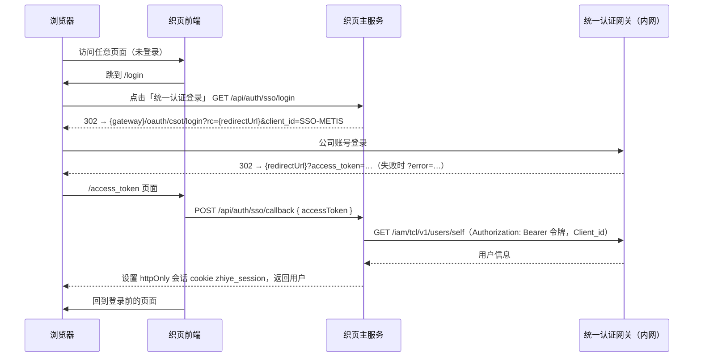

# 统一登录（SSO）接入说明

织页已经接入公司统一认证（参照 `metis-front-demo` 脚手架的流程），**默认关闭**，当前仍是免登录模式。统一认证网关只能在公司内网访问；外网开发用内置的模拟统一认证（`ZHIYE_MOCK_INTRANET=1`，见 `docs/fivestar-integration.md`）。

> 2026-11 起：回调拿到的平台令牌除了换织页会话，**前端也会保存**（localStorage，与平台前端一致），调用 `/api` 时放在 `Authorization` 头里，用于以用户身份查询五星AI岛的模型和额度。服务端仍不保存令牌。

## 流程



- 服务端用网关令牌查询用户信息，**不在服务端保存令牌**；前端按平台前端的方式把 accessToken 保存在 localStorage，之后调用 `/api` 时通过 `Authorization` 转发，用于查询五星AI岛模型、额度和 SkillHub。织页自己的会话 cookie 只存哈希，默认 7 天。
- 用户第一次登录时，当前浏览器里免登录创建的工作空间会归入该账号；之后换设备登录同一账号，看到的是同一个工作空间。
- 退出登录：侧边栏「我的工作空间」→「退出登录」。

## 开启步骤（内网环境）

1. 在技术平台为织页登记回调地址，例如 `https://zhiye.内网域名/access_token`（必须指向织页前端的 `/access_token` 路由）。
2. 配置主服务（`application.yml` 或环境变量），然后重启：

```yaml
zhiye:
  auth:
    mode: sso                      # 默认 anonymous（免登录）
    sso:
      gateway-url: http://testmetis.csot.tcl.com   # 正式环境换成正式网关
      oauth-path: /oauth/csot/login
      client-id: SSO-METIS
      redirect-url: https://zhiye.内网域名/access_token
      user-info-url:               # 留空 = {gateway-url}/iam/tcl/v1/users/self
      session-days: 7
      secure-cookie: true          # 走 HTTPS 时设为 true
```

环境变量写法：`ZHIYE_AUTH_MODE=sso`、`ZHIYE_AUTH_SSO_REDIRECT_URL=...` 等（Spring Boot 宽松绑定）。

3. 本地开发联调：回调地址 `http://127.0.0.1:8080/access_token` 需要网关允许；本机须连上公司内网或 VPN。

## 涉及的代码

| 位置 | 内容 |
|---|---|
| `web/src/pages/LoginPage.tsx` | 登录页 `/login`、回调页 `/access_token`、路由守卫 `AuthGate` |
| `web/src/components/LightLayout.tsx` | 侧边栏显示登录用户、退出登录 |
| `server/zhiye-server/src/main/java/com/tcl/csot/zhiye/service/auth/`、`client/SsoClient.java`、`controller/AuthController.java` | 配置、网关客户端、会话、过滤器、接口 |
| `server/zhiye-server/src/main/resources/db/migration/V2__auth.sql` | `app_user`、`user_session` 表 |

## 真实环境验证状态

已验证平台测试网关的 `/oauth/csot/login` 返回 302，并跳转到公司测试 SSO；完整「网关登录 → 织页回调 → 查询用户」仍需在登记织页回调地址后，用有效测试账号走一遍。用户信息字段按 metis 脚手架的 `UserSelfVo`（`id`、`loginName`、`realName`、`email`、`tenantNum`）解析，同时兼容 `{code, data}` 包装。

## 应用级登录（发布站点）

平台接入 SSO 后，每个应用可以在「发布 → 访问设置」或数据控制台里选择：内网公开（默认，不需要登录）/ 员工登录 / 指定人员。
站点登录复用平台的 SSO 回调，再用 60 秒一次性码换成应用子域名上的站点会话，流程和接口见 `docs/cloud-services.md` 第 3 节。
没有接入 SSO 时只能选「内网公开」。
